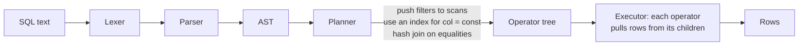

# mini-sql-engine

A small SQL engine in pure Python: a lexer, a recursive-descent parser, a planner that pushes filters down, picks indexes and chooses join algorithms, and an iterator-based executor. Its answers are checked against SQLite.

No dependencies. Python 3.10+. About 850 lines.

## From text to rows



## Supported SQL

`CREATE TABLE`, `CREATE INDEX`, `INSERT`, `EXPLAIN`, and `SELECT` with:
`DISTINCT`, expressions and aliases, `INNER JOIN` / `LEFT JOIN` (any number, self-joins with aliases), `WHERE`, `GROUP BY`, `HAVING`, `ORDER BY ... ASC|DESC`, `LIMIT` / `OFFSET`, aggregates `COUNT`, `COUNT(DISTINCT ...)`, `SUM`, `AVG`, `MIN`, `MAX`, and the operators `= != < <= > >= + - * / % AND OR NOT IN LIKE BETWEEN IS NULL`.

## Correctness: tested against SQLite

The test suite loads the same data into this engine and into SQLite, runs the same query on both and compares the results.

- 24 hand-written queries aimed at the places engines get wrong
- 6 ordering queries compared row by row
- **200 randomly generated queries** mixing joins, left joins, nested `AND`/`OR` predicates, grouping and `HAVING`
- 14 malformed queries that must raise a clear error

All of them agree with SQLite. The data deliberately contains NULLs, which is where most of the subtlety is:

| Rule | Example that would silently go wrong |
|---|---|
| A comparison with NULL is unknown, and `WHERE` keeps only true | `WHERE NOT (age > 30)` must exclude rows with a NULL age |
| `NOT IN` with a NULL in the list matches nothing | `age NOT IN (20, 21, NULL)` |
| Aggregates skip NULLs; `COUNT(*)` does not | `COUNT(*)` vs `COUNT(amount)` |
| An aggregate over zero rows still returns one row | `SELECT COUNT(*), MAX(x) ... WHERE 1 = 0` gives `(0, NULL)` |
| NULL join keys never match, even each other | hash join skips them |
| A `WHERE` filter on the nullable side of a `LEFT JOIN` cannot be pushed below the join | `LEFT JOIN b ... WHERE b.y = 2` |

## The planner at work

`python -m minisql` on generated demo data (2,000 customers, 10,000 orders):

```
> EXPLAIN SELECT c.city, COUNT(*) AS orders, SUM(o.amount) AS revenue, AVG(o.amount) AS average
          FROM customers c JOIN orders o ON o.customer_id = c.id
          WHERE o.status = 'paid' GROUP BY c.city ORDER BY revenue DESC
  Project city, orders, revenue, average, sort by 1 key(s)
    Aggregate COUNT(*), SUM(o.amount), AVG(o.amount) group by c.city
      HashJoin (inner) on o.customer_id = c.id
        Scan customers AS c
        Filter o.status = 'paid'
          Scan orders AS o
```

The `status = 'paid'` filter was written after the join but runs before it, so the join handles fewer rows.

```
> SELECT id, amount, status FROM orders WHERE customer_id = 1234 AND amount > 1000
  rows read without an index: 10,000

> CREATE INDEX orders_customer ON orders (customer_id)
> EXPLAIN SELECT id, amount, status FROM orders WHERE customer_id = 1234 AND amount > 1000
  Project id, amount, status
    Filter amount > 1000
      IndexLookup orders.customer_id = 1234
  rows read with the index:   6
```

Other planner behaviour covered by tests:

- A join with an equality uses a **hash join**; one without (`a.x > b.y`) falls back to a nested loop.
- `LIMIT 3` with no sort reads 4 rows from a 500-row table, because operators pull rows lazily. Add `ORDER BY` and it has to read all 500.

## Use it

```python
from minisql import Database

db = Database()
db.execute("CREATE TABLE users (id INT, name TEXT, city TEXT)")
db.execute("INSERT INTO users VALUES (1, 'Asha', 'Delhi'), (2, 'Ravi', 'Pune')")
db.execute("SELECT city, COUNT(*) AS n FROM users GROUP BY city ORDER BY n DESC")   # [('Delhi', 1), ('Pune', 1)]
```

```bash
pip install -e ".[dev]"
pytest -q                 # 49 tests
python -m minisql
python -m minisql "SELECT status, COUNT(*) FROM orders GROUP BY status"
```

## What it is not

A teaching engine, not a database. Data lives in memory in Python lists. There are no transactions, no `UPDATE` or `DELETE`, no subqueries, no column types or constraints (the type names in `CREATE TABLE` are accepted and ignored), and no cost-based optimiser: joins run in the order written and the index rule is a fixed heuristic. Indexes are hash maps, so they serve equality lookups only, not ranges.
